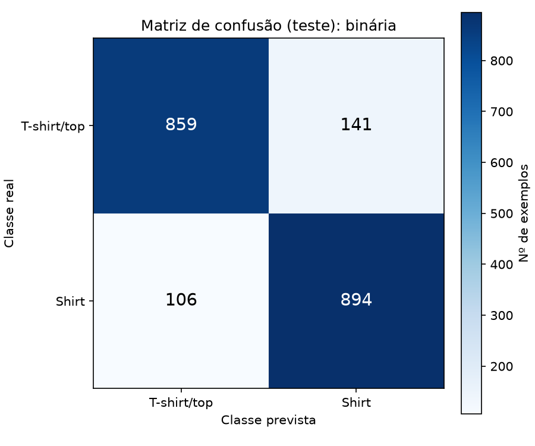
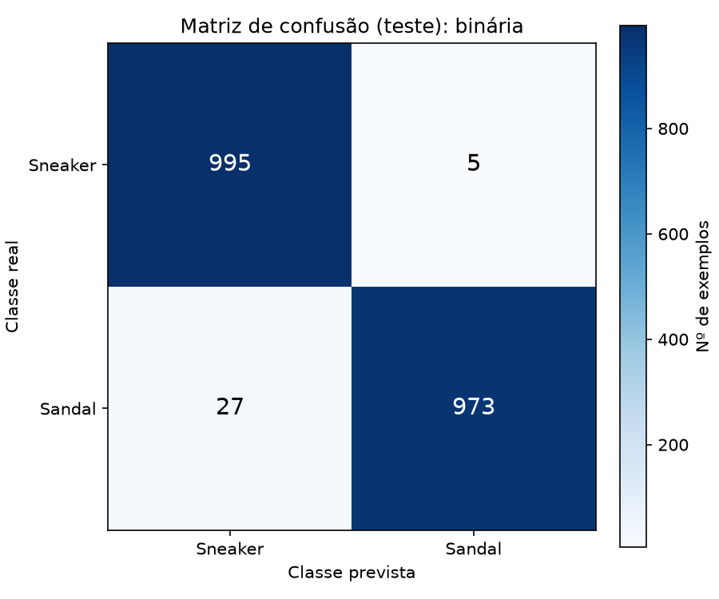
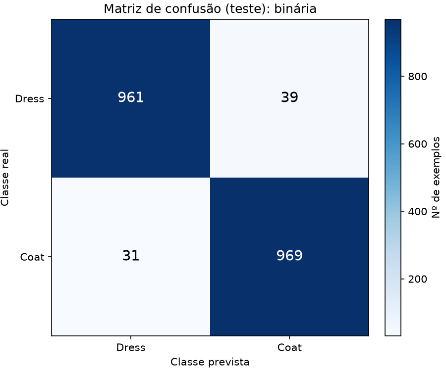
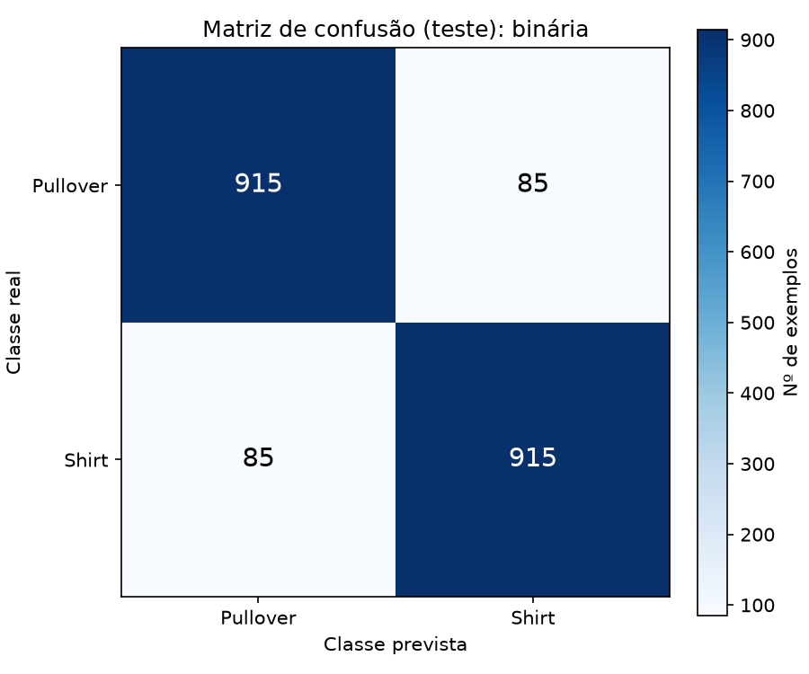

# Testes entre diferentes pares de classes para run_binary

Salvando saídas do terminal para organizar melhor as informações

## Hiperparâmetros utilizados em todos os testes

Os quatro pares foram treinados com a mesma configuração, definida no `config.yaml` (`epocas: 15`) e registrada no `hiperparametros.json` de cada par. A única diferença entre os testes é o par de classes.

**Dados**

- Normalização: `Normalize((0.5,), (0.5,))`, que leva os pixels de [0, 1] para [-1, 1].
- Divisão: 50.000 imagens de treino e 10.000 de validação (separadas do treino original com seed 42, ainda com as 10 classes) e 10.000 de teste. Depois da divisão, cada conjunto é filtrado para o par de classes e os rótulos passam a ser 0 e 1 (`classe_0` e `classe_1`).
- Em todos os pares o teste tem 2.000 imagens (1.000 por classe) e treino mais validação somam 12.000. A divisão exata entre os dois varia por par (em T-shirt/top vs Shirt, 9.893 de treino e 2.107 de validação).
- Tamanho do lote (`batch_size`): 64, com embaralhamento no treino.

**Arquitetura** (mesma do multiclasse, com `num_classes=2`)

- Bloco 1: `Conv2d` 1 -> 16 filtros (kernel 3x3, stride 1, padding 1), ReLU e `MaxPool2d` (janela 3x3, stride 2): 28x28 -> 13x13.
- Bloco 2: `Conv2d` 16 -> 32 filtros (kernel 3x3, stride 1, padding 1), ReLU e `MaxPool2d` (janela 3x3, stride 2): 13x13 -> 6x6.
- Classificador: `Flatten` (32 x 6 x 6 = 1.152) -> `Linear` 128 neurônios -> ReLU -> `Linear` 2 neurônios (logits).
- Inicialização dos pesos: padrão do PyTorch para `Conv2d` e `Linear`.

**Treinamento**

- Função de perda: `CrossEntropyLoss`.
- Otimizador: Adam, com taxa de aprendizado (`lr`) de 0,001.
- Número máximo de épocas: 15.

**Parada antecipada**

- Monitora a perda de validação, com `patience` = 3 e `delta` = 0.
- Ao parar (ou ao fim das épocas), os pesos da época com menor perda de validação são restaurados antes do teste. Por isso o número de épocas executadas varia por par (de 9 a 15).

**Reprodutibilidade e dispositivo**

- Seed 42 (divisão dos dados, embaralhamento e pesos iniciais).
- Todos os treinos foram executados em CPU.

## T-shirt/top vs Shirt

1) Parada antecipada

```
Parando antecipadamente na época: 15
```

2) Erro realizado no teste

```
Erro de Teste:
Acurácia: 87.6%, Perda Média: 0.278457
```

3) Resumo ao final

```
Melhor época: 12 | 
perda de validação: 0.2762 | 
acurácia de validação: 0.8757
```

4) Precisão, Recall, F1 e Suporte

```
Classe        Precisão     Recall         F1   Suporte
-------------------------------------------------------
T-shirt/top     0.8902     0.8590     0.8743      1000
Shirt           0.8638     0.8940     0.8786      1000
-------------------------------------------------------
Média macro     0.8770     0.8765     0.8765      2000

Erro mais frequente: 'T-shirt/top' previsto como 'Shirt' (141 exemplos)
```

5) Matriz de confusão



## Sneaker vs Sandal

1) Parada antecipada

```
Parando antecipadamente na época: 9
```

2) Erro realizado no teste

```
Erro de Teste:
Acurácia: 98.4%, Perda Média: 0.044965
```

3) Resumo ao final

```
Melhor época: 6 | 
perda de validação: 0.0409 | 
acurácia de validação: 0.9862
```

4) Precisão, Recall, F1 e Suporte

```
Classe        Precisão     Recall         F1   Suporte
-------------------------------------------------------
Sneaker         0.9736     0.9950     0.9842      1000
Sandal          0.9949     0.9730     0.9838      1000
-------------------------------------------------------
Média macro     0.9842     0.9840     0.9840      2000

Erro mais frequente: 'Sandal' previsto como 'Sneaker' (27 exemplos)
```

5) Matriz de confusão




## Dress vs Coat

1) Parada antecipada

```
Parando antecipadamente na época: 13
```

2) Erro realizado no teste

```
Erro de Teste:
Acurácia: 96.5%, Perda Média: 0.079003
```

3) Resumo ao final

```
Melhor época: 10 | 
perda de validação: 0.0823 | 
acurácia de validação: 0.9588
```

4) Precisão, Recall, F1 e Suporte

```
Classe        Precisão     Recall         F1   Suporte
-------------------------------------------------------
Dress           0.9688     0.9610     0.9649      1000
Coat            0.9613     0.9690     0.9651      1000
-------------------------------------------------------
Média macro     0.9650     0.9650     0.9650      2000

Erro mais frequente: 'Dress' previsto como 'Coat' (39 exemplos)
```

5) Matriz de confusão



## Pullover vs Shirt

1) Parada antecipada

```
Parando antecipadamente na época: 11
```

2) Erro realizado no teste

```
Erro de Teste:
Acurácia: 91.5%, Perda Média: 0.227070
```

3) Resumo ao final

```
Melhor época: 8 | 
perda de validação: 0.1721 | 
acurácia de validação: 0.9286
```

4) Precisão, Recall, F1 e Suporte

```
Classe        Precisão     Recall         F1   Suporte
-------------------------------------------------------
Pullover        0.9150     0.9150     0.9150      1000
Shirt           0.9150     0.9150     0.9150      1000
-------------------------------------------------------
Média macro     0.9150     0.9150     0.9150      2000

Erro mais frequente: 'Pullover' previsto como 'Shirt' (85 exemplos)
```

5) Matriz de confusão



## Comparação entre os pares

Pares ordenados do mais difícil para o mais fácil (pela acurácia de teste):

| Par | Acurácia de teste | F1 macro | Erros no teste (de 2.000) | Acurácia de validação | Melhor época | Parou na época |
|---|---|---|---|---|---|---|
| T-shirt/top vs Shirt | 87,65% | 0,8765 | 247 | 87,57% | 12 | 15 |
| Pullover vs Shirt | 91,50% | 0,9150 | 170 | 92,86% | 8 | 11 |
| Dress vs Coat | 96,50% | 0,9650 | 70 | 95,88% | 10 | 13 |
| Sneaker vs Sandal | 98,40% | 0,9840 | 32 | 98,62% | 6 | 9 |

Comentários:

- **Os pares com Shirt são os mais difíceis.** Os dois piores resultados (247 e 170 erros) contêm a classe Shirt, enquanto o par de calçados errou apenas 32 imagens. Uma explicação plausível é que camisa, camiseta e pulôver são peças de parte de cima com formas parecidas (mangas, gola, botões), enquanto tênis e sandália têm silhuetas bem diferentes. Isso é uma hipótese: as matrizes mostram onde a rede erra, mas não o motivo visual.
- **Os erros nem sempre são simétricos.** Em Sneaker vs Sandal, a maior parte dos erros é de sandálias classificadas como tênis (27 contra 5). Em T-shirt/top vs Shirt, camisetas classificadas como camisa (141) superam o contrário (106). Já em Pullover vs Shirt os dois sentidos têm o mesmo número de erros (85 e 85), e em Dress vs Coat ficam próximos (39 e 31).
- **A parada antecipada acompanha a dificuldade nos extremos.** O par mais difícil teve a melhor época na 12 e o mais fácil na 6. Os dois pares intermediários não seguem essa ordem (Dress vs Coat na 10 e Pullover vs Shirt na 8), então isso é uma tendência, e não uma regra.
- **Cada par foi treinado uma única vez, com uma seed.** A diferença entre os extremos (87,65% e 98,40%) é grande demais para ser acaso, mas diferenças de cerca de 1 ponto percentual entre pares próximos não devem ser interpretadas. Em Pullover vs Shirt, por exemplo, a acurácia cai de 92,86% na validação para 91,50% no teste, o que pode ser em parte variação amostral (o teste tem 2.000 imagens, com erro-padrão de cerca de 0,6 ponto percentual).
